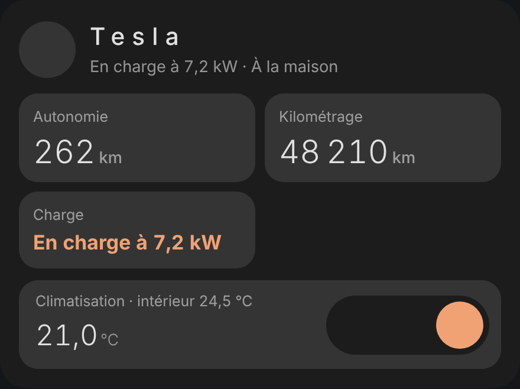
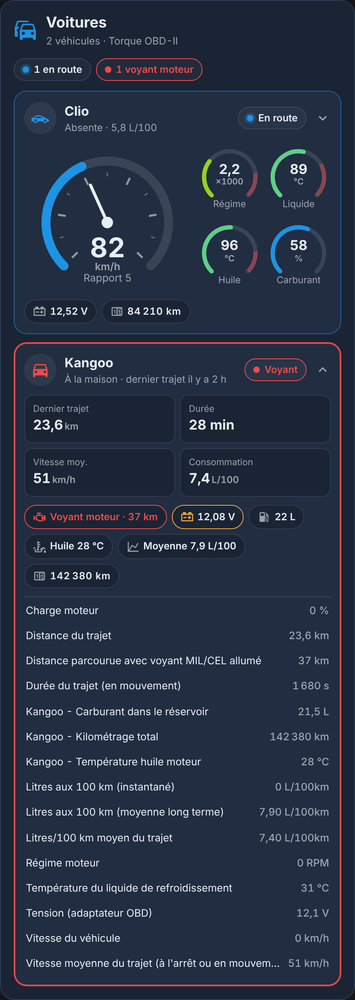
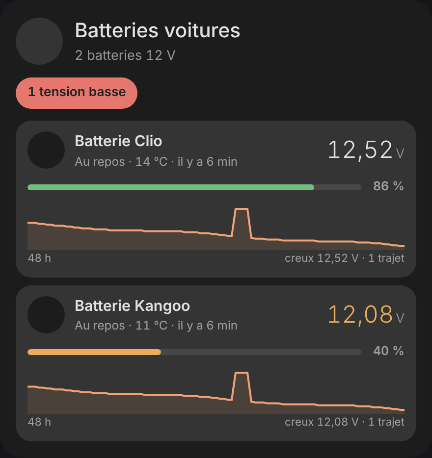
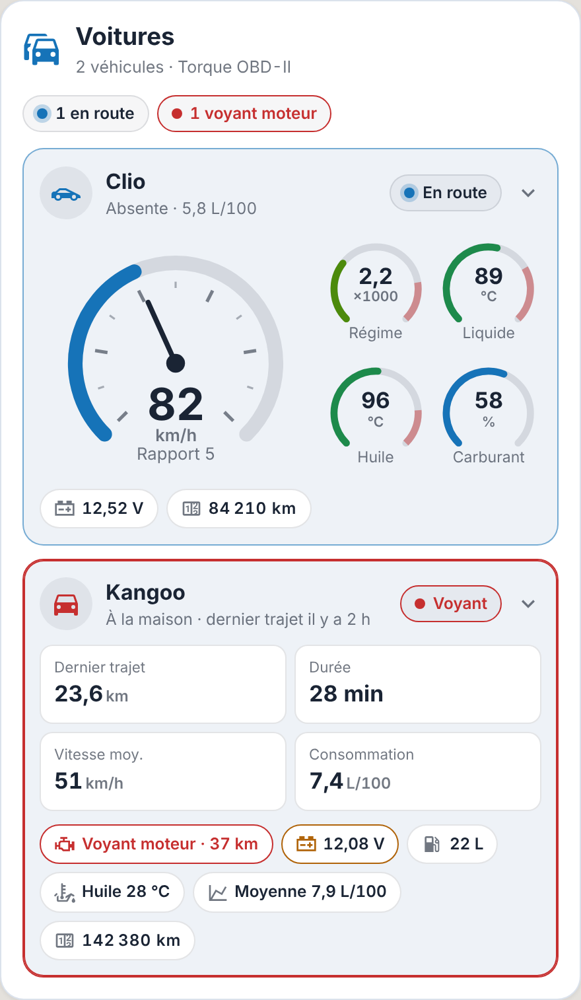
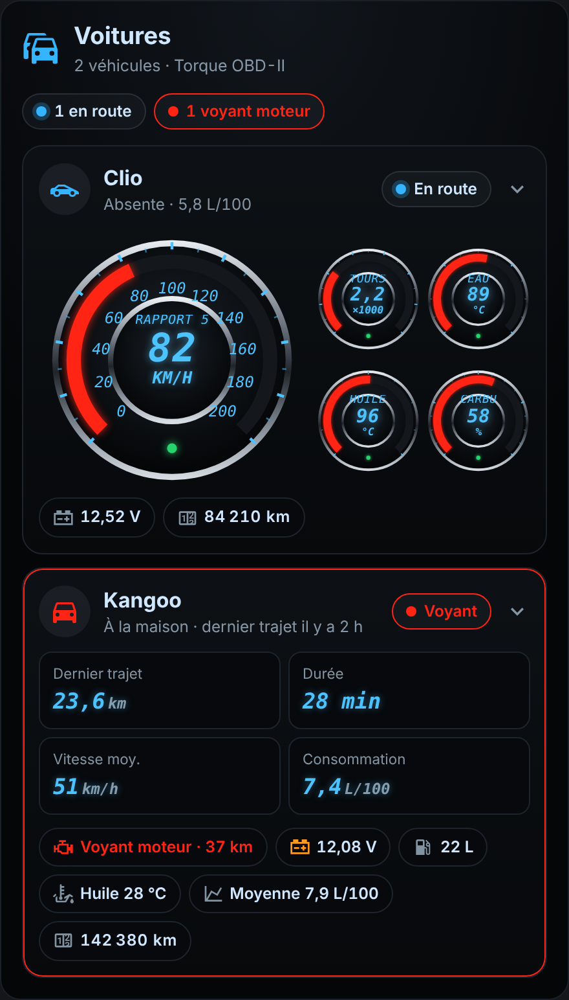
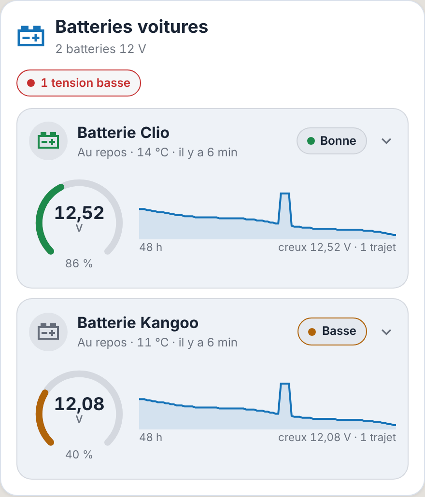

<p>
  ☕ <strong>Si cette carte vous est utile, vous pouvez soutenir le projet :</strong>
</p>

<div style="white-space: nowrap; line-height: 0;">
  <a
    href="https://www.buymeacoffee.com/Marlboro62"
    target="_blank"
    rel="noopener noreferrer"
    style="display: inline-block; text-decoration: none; vertical-align: middle;"
  ></a>&nbsp;&nbsp;<a
    href="https://ko-fi.com/M4M2QL45X"
    target="_blank"
    rel="noopener noreferrer"
    style="display: inline-block; text-decoration: none; vertical-align: middle;"
  ></a>
</div>

# Cartes Voitures

Cartes Lovelace pour Home Assistant, dans un seul fichier, pour suivre ses voitures : **électriques**, **hybrides rechargeables** et **thermiques**, ainsi que leurs **batteries 12 V**.

| Carte | Rôle | Trouvée seule avec |
| --- | --- | --- |
| `custom:voiture-electrique-card` | **Voiture électrique ou hybride rechargeable** : batterie, autonomie, kilométrage, charge, climatisation, verrouillage | Tesla (Fleet, Teslemetry, Tessie, Tesla custom) ; autre marque : choisir la batterie |
| `custom:voiture-thermique-card` | **Voitures suivies par Torque Pro** : en route (vitesse, régime, températures, consommation) ou dernier trajet, voyant moteur, carburant, kilométrage | intégration [Torque OBD-II](https://github.com/Marlboro62/Home-Assistant-Torque-OBDII-2027) |
| `custom:voiture-batteries-card` | **Batteries 12 V** : tension, charge, état, courbe de tension et trajets | boîtiers BM6, intégration [Battery Monitor BM6](https://github.com/Marlboro62/hass-bm6) |

| Voiture électrique | Voitures Torque, détail | Batteries 12 V |
| --- | --- | --- |
|  |  |  |

*Aperçus réalisés avec la démo et des données fictives (voitures, batteries et proxy inventés).*

**[▶ Essayer la démo en ligne](https://marlboro62.github.io/voitures-electriques-hybrides-rechargeables/docs/demo.html)** : les trois cartes avec des données simulées, en clair ou en sombre, avec le YAML à copier.

## Installation

### Avec HACS (recommandé)

1. Dans HACS, cherchez **Cartes Voitures** et installez-les.
2. Rechargez la page (Ctrl+F5).

Si la carte n'apparaît pas encore dans la recherche de HACS, ajoutez le dépôt à la main : menu **⋮** → **Dépôts personnalisés**, adresse `https://github.com/Marlboro62/voitures-electriques-hybrides-rechargeables`, type **Tableau de bord** (Dashboard), puis cherchez **Cartes Voitures**.

### Manuellement

1. Téléchargez [`voitures-cards.js`](https://raw.githubusercontent.com/Marlboro62/voitures-electriques-hybrides-rechargeables/main/voitures-cards.js) (clic droit → Enregistrer sous) et copiez-le dans `/config/www/`.
2. **Paramètres → Tableaux de bord → ⋮ → Ressources → Ajouter une ressource** : URL `/local/voitures-cards.js`, type **Module JavaScript**.
3. Rechargez la page (Ctrl+F5).

### Vous utilisiez ces cartes dans les Cartes Maison HA

Ces trois cartes viennent des [Cartes Maison HA](https://github.com/Marlboro62/maison-ha-cards). Leurs anciens noms restent reconnus : `maison-voiture-card`, `maison-torque-card` et `maison-batteries-card` fonctionnent toujours avec ce fichier. Vous pouvez donc désinstaller les Cartes Maison HA sans toucher à vos tableaux de bord, puis remplacer les noms à votre rythme :

| Ancien nom | Nouveau nom |
| --- | --- |
| `custom:maison-voiture-card` | `custom:voiture-electrique-card` |
| `custom:maison-torque-card` | `custom:voiture-thermique-card` |
| `custom:maison-batteries-card` | `custom:voiture-batteries-card` |

## Thèmes

Toutes les cartes acceptent `theme` :

| Valeur | Rendu |
| --- | --- |
| `v2` (défaut) | Style MyElectricalData bleu nuit, comme les autres cartes |
| `maison` | Suit votre thème Home Assistant (clair ou sombre), avec des touches de couleur pastel |
| `auto` | Style MyElectricalData, clair ou sombre selon Home Assistant |
| `ha` | Couleurs du thème Home Assistant |
| `obd` | Tableau de bord façon application OBD : cadrans noirs à lunette chromée, arc rouge, graduations et chiffres bleu cyan |

## Voiture électrique ou hybride rechargeable — `custom:voiture-electrique-card`

```yaml
type: custom:voiture-electrique-card
name: tesla
battery: sensor.tesla_battery       # le reste est trouvé sur le même appareil
```

`range`, `odometer`, `charging` (binary_sensor ou état de charge texte), `plugged`, `charger_power`, `charge_limit`, `climate`, `inside_temp`, `lock` (déverrouillage en deux clics), `location`, `charge_switch`, `prefix`, `icon`.

## Voitures thermiques (Torque OBD-II) — `custom:voiture-thermique-card`

```yaml
type: custom:voiture-thermique-card
```

Les voitures de l'intégration [Torque OBD-II](https://github.com/Marlboro62/Home-Assistant-Torque-OBDII-2027) (application Torque Pro) sont trouvées seules. Chaque capteur est reconnu par sa clé Torque (attribut `pid`), même si l'entité a été renommée. Pour chaque voiture :

- **en route** (Torque connecté) : un **compteur de vitesse** à aiguille (rapport engagé en dessous) et des **cadrans** pour le régime, le liquide de refroidissement (rouge à partir de 105 °C), l'huile et le turbo, le carburant ou la consommation ;
- **à l'arrêt** : le **dernier trajet** (distance, durée, vitesse moyenne, consommation) et depuis quand ;
- la **zone** (« À la maison », « Absente » ou le nom de la zone, jamais l'adresse ni la carte) ;
- des pastilles : **voyant moteur** (distance parcourue voyant allumé, en rouge), **batterie** (tension du boîtier BM6 dont le nom contient celui de la voiture, ex. « Batterie Clio » pour « Clio »), **carburant**, **kilométrage** (PID propre au véhicule, ex. « Laguna - Kilométrage total ») et consommation moyenne.

**PID propres au véhicule** (définitions personnalisées `torque_sensor_definitions.yaml`), reconnus d'après leur clé :

- Renault Laguna III (Mode 22) : kilométrage total (`k222006`), carburant dans le réservoir (`k222201`, sinon `k22287f`), température d'huile (`k222007`), puissance de l'alternateur, cumul des démarrages ; vitesse, régime, liquide de refroidissement et air d'admission (`k222001` à `k222003`, `k22240d`) servent de secours si les PID standard ne sont pas lus ;
- Mercedes SLK R170 (bloc `21 01`) : température d'huile (`k2101_slktemp33`), pression de suralimentation (`k2101_slkpres29`) et rapport engagé (`k2101_slkgear`).

En route, l'huile (rouge à partir de 130 °C), le turbo et le rapport s'ajoutent au tableau de bord ; à l'arrêt, la dernière température d'huile apparaît en pastille.

Un clic sur une voiture liste **tous ses capteurs** par ordre alphabétique, sauf les coordonnées GPS (latitude, longitude, altitude, cap), jamais affichées ; un appui long ouvre la fiche « Torque connecté ». À l'arrêt, les valeurs de trajet à zéro (Torque les remet à zéro quand il se reconnecte sans rouler) sont masquées.

`devices` (vide = toutes), `show_location` (`true`), `show_battery` (`true`), `max_speed` (`200` km/h, fin du compteur), `max_rpm` (`7000` tr/min), `title`, `icon`.

Quand le nom du boîtier BM6 ne reprend pas celui de la voiture, choisissez sa batterie à la main avec `batteries` (nom de l'appareil BM6, ou capteur de tension) :

```yaml
type: custom:voiture-thermique-card
batteries:
  Mercedes: Batterie SLK
  Renault: sensor.batterie_laguna_tension
```

| Sombre, tous les capteurs | Clair | Thème `obd` |
| --- | --- | --- |
|  |  |  |

## Batteries 12 V (BM6) — `custom:voiture-batteries-card`

```yaml
type: custom:voiture-batteries-card
```

Les batteries 12 V suivies par un boîtier **BM6** (intégration [Battery Monitor BM6](https://github.com/Marlboro62/hass-bm6), HACS) sont trouvées seules, même si leurs entités ont été renommées ou masquées. Pour chacune :

- **tension** en grand, en orange sous `volt_warn` (12,3 V), en rouge sous `volt_alert` (12,0 V) ;
- **charge** en % avec sa barre, l'état (« Au repos », « En charge »), la température et l'heure de la dernière mesure ;
- au-dessus de **13,2 V**, la carte affiche « Moteur en marche » et un éclair : l'alternateur recharge la batterie ;
- une **courbe de tension** sur `hours` heures (48 par défaut), à l'échelle de la tension au repos pour voir la lente décharge, avec le **creux** de la période et le nombre de **trajets** (passages au-dessus de 13,2 V).

Un clic sur une batterie affiche son détail : charge calculée et charge selon le BM6, état du BM6 (« Tension basse »…), température, baisses et hausses rapides de tension, signal Bluetooth et proxy qui la capte, dernière mesure. Un appui long ouvre la fiche de la tension.

Une voiture partie (aucune mesure depuis `stale_hours` heures, 3 par défaut) passe en **gris** avec « Hors de portée depuis… ». L'en-tête compte les batteries en **tension basse** et **hors de portée**.

`devices` (vide = toutes), `volt_warn`, `volt_alert`, `hours`, `show_curve` (`true`), `stale_hours` (`0` = jamais), `title`, `icon`.

| Sombre, détail d'une batterie | Clair |
| --- | --- |
|  |  |

## Confidentialité

La carte des voitures thermiques n'affiche jamais les coordonnées GPS (latitude, longitude, altitude, cap) : seulement la zone (« À la maison », « Absente » ou le nom de la zone).

## Licence

MIT
